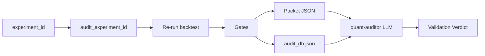

# Architecture — Quant Audit Agent MVP

## Principle

**Evidence before narrative.** Sharpe is never the first test. Leak and point-in-time checks run before PSR/DSR. The LLM interprets a packet; it does not invent gates.

## Three layers

### 1. Frozen layer (Python)

- **Owner:** `engine/audit.py`, `leaks.py`, `stats.py`, `backtest.py`
- **Input:** Frozen `experiments/*.json`, optional `PROTOCOL.md`, prior `reports/<id>.json`
- **Output:** Gate map + metrics + `action` + findings
- **Property:** Deterministic given seed and files. LLM cannot change PASS/FAIL.

### 2. Hard gates (code-owned)

Any FAIL here forces overall **FAIL**. High PSR does not override leak FAIL.

| Gate | Question |
|---|---|
| reproduce | Does a fresh run match the stored report? |
| leak | Does signal use same-bar return with zero delay? |
| pit | Does signal change when a future close is mutated? |
| execution | Realistic: delay ≥ 1 and commission > 0? |
| freeze | Do dates/costs/files still match PROTOCOL? |
| stats (FAIL only) | \|Sharpe\| > 2 on **synthetic** realistic? |

`stats: WEAK` (PSR < 0.95) is **not** a hard FAIL.

### 3. Critic layer (LLM)

- **Owner:** `agents/quant-auditor.md`
- **Input:** CLI stdout/stderr + `audit_db` read-back
- **Output:** Structured markdown verdict (PASS/FAIL prose + quoted packet)
- **May:** Explain findings, check PAPER faithfulness on replicate
- **May not:** Override `passed_audit`, skip frozen run, read raw vendor blobs

## Verdict enums

| Internal (slide) | Desk action | Meaning |
|---|---|---|
| DISCARD | **kill** | Illegal signal or implausible synthetic Sharpe |
| ITERATE | **modify** | Fix reproduce/protocol/costs; re-audit |
| — | **pause** | Legal; not alpha; not PROMOTE |

PROMOTE is **out of scope** for this agent.

## Data flow

## Contracts

### Experiment JSON (minimum)

- `id`, `ticket`, `strategy`, `universe`, `start`, `end`, `costs`, `metrics`
- Optional `data`: `{ "source": "synthetic"|"vendor", "root", "frequency" }`

### Ledger row (append-only)

See `LEDGER.md`. One row per `audit run` invocation; keyed by `experiment_id` + `run_id`.

## Independence

- Validator model **≠** backtester/coder model (Haiku vs Gemini Flash on this gateway).
- Validator is **read-only** (no strategy edits, no PROTOCOL edits).
- Run `audit` **once** per validation turn (duplicate runs = duplicate ledger rows).
